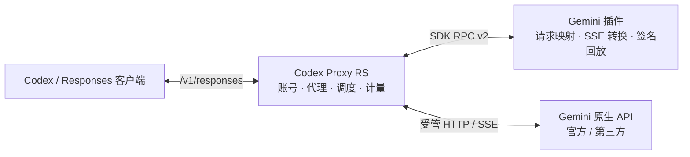

<div align="center">

# Gemini for Codex Proxy RS

**原生 Gemini API，熟悉的 Responses 工作流。**

为 Codex Proxy RS 提供独立的 Gemini 上游适配器。<br>
连接官方或第三方 Gemini 服务，保留宿主的账号调度、代理、背压与用量管理。

[](https://github.com/fraternity-z/cpr-plugin-gemini/actions/workflows/ci.yml)
[](https://github.com/fraternity-z/cpr-plugin-gemini/releases)
[](rust-toolchain.toml)
[](#许可证)

[快速开始](#快速开始) · [配置参考](#配置参考) · [兼容性](#兼容性) · [构建与发布](#构建与发布) · [故障排查](#故障排查)

</div>

---

## 项目定位

`cpr-plugin-gemini` 将 **OpenAI Responses** 请求转换为 Gemini 原生的 `streamGenerateContent` 调用，再将结果转换回 Responses 事件或非流式响应。

它不是独立代理服务，不修改宿主业务模块，也不读取本机 Gemini 登录文件。生产代码仅通过公开的 `gateway-plugin-sdk` 接入宿主。

| 能力 | 实现方式 |
| --- | --- |
| 官方与第三方上游 | 自定义 HTTPS Base URL、完整路径前缀、模型 ID，以及两种 Key 鉴权方式 |
| 流式与非流式输出 | 增量解析 Gemini SSE；向宿主提供 Responses wire 事件与终态 |
| 客户端工具 | 函数、自定义工具、命名空间、并行调用与客户端执行的 `tool_search` |
| 多轮思考与签名 | 保留 Gemini 原始签名分段，通过 Responses reasoning 项回放 |
| 图片与结构化输出 | 支持 Base64 图片输入，以及 JSON / JSON Schema 输出配置映射 |
| 宿主原有能力 | 沿用账号选择、代理、背压、取消、重试与计量链路，不另建直连通道 |



> [!IMPORTANT]
> 客户端连接的是 **Codex Proxy RS**，不是 Gemini 上游。Gemini API Key 保存在宿主的 URL + Key 账号中；插件配置不接受 API Key。

## 快速开始

### 1. 确认运行环境

| 项目 | 要求 |
| --- | --- |
| 宿主 | 清单声明 `>=3.26.1, <4.0.0`；SDK 与协议实现以 **v3.26.1** 为基线，不代表逐一验收了整个版本范围 |
| 发行平台 | **Linux x86_64**，目标 `x86_64-unknown-linux-gnu` |
| 系统依赖 | **glibc 2.34+** 与 `libgcc_s.so.1`；不是 Alpine / musl 安装包 |
| 插件标识 | `cpr-community.gemini`，适配器 ID 为 `gemini-api` |
| 运行方式 | `trustedProcess`；清单、RPC 与 `upstream_adapter` 均使用 v2 |
| 上游 | 提供 Gemini 原生 `models/{model}:streamGenerateContent?alt=sse` 端点的服务 |

Windows 可用于源码开发与测试，但当前工作流只发布 Linux x86_64 安装包；Windows 下构建该包请使用 WSL。暂不提供 ARM64 或 macOS 发行资产。

> [!WARNING]
> 宿主的 `trustedProcess` 插件拥有宿主进程身份，不是安全沙箱。只安装可信来源；SHA-256 校验能核对文件内容，不能证明发布者可信。

### 2. 下载并安装插件

从 [Releases](https://github.com/fraternity-z/cpr-plugin-gemini/releases) 下载同一版本的两个文件：

```text
cpr-community.gemini-<version>-x86_64-unknown-linux-gnu.tar.gz
cpr-community.gemini-<version>-x86_64-unknown-linux-gnu.tar.gz.sha256
```

将它们放在同一目录，校验后安装。以下以 `0.1.4` 为例，实际使用下载的版本号：

```bash
VERSION=0.1.4
PACKAGE="cpr-community.gemini-${VERSION}-x86_64-unknown-linux-gnu.tar.gz"
sha256sum --check "${PACKAGE}.sha256"
```

在宿主的 **插件管理 → 安装** 中任选一种来源：

- **上传包**：上传上述 `.tar.gz`，核对名称、平台与摘要后确认。
- **GitHub**：填写 `fraternity-z/cpr-plugin-gemini`。标签留空使用最新稳定版；预发行版需要明确指定标签。

不要选择 GitHub 自动生成的 **Source code** 归档。若尚未发布 Release，可先[手动构建](#手动构建)，解开 Actions artifact 的外层 ZIP，再上传其中的 `.tar.gz`。

宿主安装后可能按默认配置直接启用插件。**“已启用”不等于上游已经配置完成或调用成功**，请继续完成下面的账号与范围设置。

### 3. 设置上游与账号

在插件设置中填写：

```json
{
  "baseUrl": "https://generativelanguage.googleapis.com/v1beta/",
  "authMode": "x-goog-api-key",
  "models": ["gemini-2.5-flash", "gemini-2.5-pro"]
}
```

然后在宿主中完成以下设置：

1. 创建 **OpenAI 类型的 URL + Key 账号**，填入实际的 Gemini API Key。
2. 账号的 **Base URL 必须与插件 `baseUrl` 一致**，包括路径前缀；传输选择 **HTTP / SSE**。
3. 建立专用账号分组，只放入该 Gemini 上游的账号，不混入普通 OpenAI 账号或其他 Base URL 的账号。
4. 将插件的 **`upstream` 绑定**限制到该账号组、对应客户端 Key、OpenAI Provider 与所需模型，并让客户端 Key 只使用这个分组。
5. 关闭该客户端 Key 的 **OpenAI Fast / priority**，避免宿主注入 Gemini 不支持的服务档位。
6. 保存配置并启用插件；客户端手动选择 `models` 中的模型 ID。

> 一个插件配置对应一个 `baseUrl`。同一上游可以配置多个 Key，但不要把不同地址混进同一分组。宿主 v3.26.1 对同一插件只允许一个启用实例。

### 4. 配置客户端并发起请求

| 客户端项目 | 应填写的内容 |
| --- | --- |
| API Base URL | **宿主地址 + `/v1`**，例如 `https://proxy.example.com/v1` |
| API Key | **宿主签发的客户端 Key**，不是 Gemini API Key |
| 模型 | 与插件 `models` 完全一致的 ID |
| 协议与传输 | Responses，HTTP / SSE；不要使用原生 WebSocket 续接 |
| 会话策略 | 完整历史、`store=false`、非后台请求 |

以下为 Bash 调用示例。将示例域名换成宿主地址，运行时输入客户端 Key；**该请求会访问真实上游，可能产生费用**。

```bash
CPR_BASE_URL="https://proxy.example.com/v1"
read -r -s -p "宿主 Client Key: " CPR_CLIENT_KEY
printf '\n'

curl --fail-with-body --no-buffer \
  "${CPR_BASE_URL%/}/responses" \
  -H "Authorization: Bearer ${CPR_CLIENT_KEY}" \
  -H "Content-Type: application/json" \
  --data-binary '{
    "model": "gemini-2.5-flash",
    "input": [{"role": "user", "content": "用两句话介绍 Rust。"}],
    "stream": true,
    "store": false,
    "background": false,
    "include": ["reasoning.encrypted_content"],
    "client_metadata": {"client": "readme-example"},
    "stream_options": {
      "include_usage": true,
      "include_obfuscation": false
    }
  }'

unset CPR_CLIENT_KEY
```

非流式调用时，将 `stream` 改为 `false` 并移除 `stream_options`。插件仍通过受管 SSE 访问 Gemini，向宿主提交终态事件，由宿主聚合成 JSON 响应。

## 配置参考

所有配置项均来自 [plugin.json](plugin.json)。未知配置字段会被拒绝。

| 字段 | 默认值 | 说明 |
| --- | --- | --- |
| `baseUrl` | `https://generativelanguage.googleapis.com/v1beta/` | Gemini 原生 API 基址，保留完整路径前缀；未带末尾 `/` 时自动补齐 |
| `authMode` | `x-goog-api-key` | `x-goog-api-key` 或 `bearer`，后者发送 `Authorization: Bearer` |
| `models` | `gemini-2.5-flash`、`gemini-2.5-pro` | 1–64 个唯一模型 ID，精确匹配，不支持通配符 |

**Base URL 规则**：远程地址必须使用 HTTPS；HTTP 仅允许回环地址。不允许用户名、密码、查询参数或 fragment，不要把 Key 填进 URL。

**模型 ID 规则**：最长 128 字符，以英文字母或数字开头，其余字符仅允许字母、数字、`.`、`_`、`-`。不包含 `models/` 前缀，也不包含方法后缀。

### 第三方 Gemini 服务

第三方必须支持 **Gemini 原生协议**，只有 OpenAI 兼容端点的服务不能直接使用此配置。以下域名和模型别名仅为示例，请替换为服务商提供的实际值：

```json
{
  "baseUrl": "https://gateway.example.com/vendor/gemini/v1beta/",
  "authMode": "bearer",
  "models": ["gemini-2.5-flash", "vendor-gemini-pro"]
}
```

对于模型 `vendor-gemini-pro`，最终调用路径为：

```text
POST https://gateway.example.com/vendor/gemini/v1beta/models/vendor-gemini-pro:streamGenerateContent?alt=sse
```

无需把域名伪装成 Google。服务商使用标准 Gemini Key 头时，改为 `"authMode": "x-goog-api-key"` 即可。账号 Base URL 与分组隔离规则仍然适用。

自定义模型别名可以用于普通生成，但不自动推断模型代际；如果发送 `reasoning.effort` 却没有对应映射，请省略该选项或使用服务商支持、且插件能够识别代际的真实模型 ID。

## 兼容性

### 支持的协议能力

| 能力 | 范围与边界 |
| --- | --- |
| 文本与指令 | `input` 文本或消息数组；`instructions`、system / developer 消息 |
| 图片输入 | PNG、JPEG、WebP、GIF 的 `data:image/...;base64,...`；不抓取远程 URL 或文件 ID |
| 生成参数 | `max_output_tokens`、`temperature`、`top_p` 与 `text.format` 的 JSON / JSON Schema 映射；仍受上游能力限制 |
| 工具调用 | 函数、自定义工具、命名空间、并行调用、调用结果回传；工具由客户端执行 |
| 动态工具发现 | `tool_search` 仅支持 `execution=client`；支持后续 `tool_search_output` 及 developer `additional_tools` 加载声明 |
| 工具去重 | 相同动态定义去重，冲突报错；初始与动态加载的工具合计最多 128 个 |
| 思考配置 | 对已识别模型代际映射 `reasoning.effort`；支持思考摘要与原始签名分段回放 |
| 客户端元数据 | 接受对象形式的 `client_metadata`，不向上游转发、不回显、不记录其中的值 |
| 流式提示 | 接受 `include_usage` 布尔值、`include_obfuscation=false` 与 `reasoning_summary_delivery=sequential_cutoff` |
| Token 用量 | 将上游累计快照映射到输入、输出、缓存与思考用量；费用仍由宿主处理 |

`reasoning.context` 只接受省略、`null` 或 `auto`，不提供 OpenAI 专属上下文选择语义。自定义工具的 grammar 会作为输入格式提示传给 Gemini，**不等于原生 CFG 强制约束**。

### 网页搜索的兼容策略

**无需客户端或上游提供“关闭 web search”的开关，但本插件不执行 Gemini 原生联网搜索。**

| 请求情形 | 行为 |
| --- | --- |
| 顶层可选 `web_search` / `web_search_preview` 及已知日期版本声明 | 移除声明后继续处理其他内容；响应 `tools` 只回显保留项 |
| 移除上述声明时的 `web_search_call.action.sources` | 同步从 `include` 中移除 |
| 同名客户端函数、自定义工具或命名空间 | 按工具 `type` 精确区分，不误删 |
| 强制选择网页搜索、已有真实搜索历史、动态加载托管搜索工具 | 明确报错，不伪造搜索结果 |
| `tool_choice=required` | 只有移除网页搜索后仍存在可用客户端工具时才接受 |

### 多轮对话与思考签名

后续请求应携带：**此前完整输入 + 上轮完整 `output` 数组 + 新输入或工具结果**。

必须保留 `output` 中的 reasoning、工具调用、`call_id` 及签名回放字段，不要只保留可见文本，也不要重新拼接或改写签名分段。reasoning 中的 `encrypted_content` 在这里是插件的不透明回放载体，不应被当作额外的加密存储保证。

不使用 `previous_response_id` 代替完整历史，也不要把一个模型的签名状态复用到另一个模型。

### 明确不支持

- Google OAuth、Gemini 本机登录凭据，以及插件自身的 `/v1/models` 自动发现。
- `store=true`、后台执行、`previous_response_id` / `conversation` 续接与服务端自动压缩、截断。
- 托管搜索／文件工具、远程图片抓取、音视频输出，以及强制串行工具调用。
- OpenAI Fast / priority、访问计划与 WebSocket 专属控制字段。
- 将 Gemini 别名映射成 GPT 模型以套用其价格；未知价格不由插件伪造。

可选字段的 `null` 视为未设置；不支持的非空语义会明确拒绝，不以静默丢弃冒充兼容。

### 资源上限

| 项目 | 上限 |
| --- | --- |
| 请求正文 | 16 MiB |
| 响应回显设置 | 128 KiB |
| 模型输出状态 | 256 KiB |
| 签名回放状态 | 256 KiB |
| 输入历史项 | 4096 项 |
| 工具总数 | 128 个 |

超限会报错，不会截断成看似成功的响应。

## 构建与发布

### 本地开发

仓库通过 [rust-toolchain.toml](rust-toolchain.toml) 固定 Rust **1.97.0**、rustfmt 与 Clippy；依赖由 `Cargo.lock` 锁定。请确保 `cargo`、`rustc`、`cargo-clippy` 与 `rustfmt` 来自同一套工具链，尤其不要混用 WSL 系统自带的旧组件。

```bash
git clone https://github.com/fraternity-z/cpr-plugin-gemini.git
cd cpr-plugin-gemini

cargo fmt --all -- --check
cargo clippy --all-targets --all-features --locked -- -D warnings
cargo test --locked
```

测试包含纯转换测试，以及启动真实插件子进程的离线 SDK RPC 测试，覆盖注册约束、第三方鉴权、分片 SSE、非流式终态、三轮工具调用、背压、取消与失败回收。**测试不调用外部模型，也不需要真实 API Key**；首次下载构建依赖仍需要网络。

修改工作流时，可安装 [actionlint](https://github.com/rhysd/actionlint) 并检查 Actions 语法与表达式：

```bash
actionlint .github/workflows/ci.yml .github/workflows/release.yml
```

### 本地打包

在 Linux x86_64 环境中安装与 SDK **同一提交**的打包 CLI，再调用现有脚本：

```bash
cargo install --locked \
  --git https://github.com/zyycn/codex-proxy-rs.git \
  --rev 5358de53ddd4bda529cb63c422fd5c6af070f9c9 \
  --root "$PWD/target/plugin-cli" \
  --target-dir "$PWD/target/plugin-cli-build" \
  codex-proxy-plugin-cli

CPR_PLUGIN_CLI="$PWD/target/plugin-cli/bin/cpr-plugin" \
  bash scripts/package.sh
```

输出为 `dist/` 下的安装归档及同名 `.sha256`。`CPR_PLUGIN_CLI` 可指定 CLI 路径，`CARGO_TARGET_DIR` 可指定编译输出目录。若更新 SDK 提交，CLI 也必须同步，不能只修改清单中的兼容版本。

发行前还应解包并对 **包内二进制**运行回归，而不只测试源码构建结果：

```bash
VERSION=0.1.4
PACKAGE="cpr-community.gemini-${VERSION}-x86_64-unknown-linux-gnu.tar.gz"
(cd dist && sha256sum --check "${PACKAGE}.sha256")

CHECK_DIR="$(mktemp -d "$PWD/target/package-check.XXXXXX")"
tar -xzf "dist/$PACKAGE" -C "$CHECK_DIR"
CPR_PLUGIN_TEST_BINARY="$CHECK_DIR/bin/cpr-plugin-gemini" \
  cargo test --test rpc --locked

readelf --version-info "$CHECK_DIR/bin/cpr-plugin-gemini"
```

在较新系统本地编译可能抬高 glibc 要求，应以 `readelf` 实测为准；需要更旧系统时，在相应基线环境重新构建。Windows 调用 WSL 请使用 PowerShell，避免 Git Bash 改写 `/mnt/...` 参数，并为 Linux 单独设置 `CARGO_HOME` 与 `CARGO_TARGET_DIR`，不要与 Windows 共用编译缓存。

### GitHub Actions

| 工作流 | 触发条件 | 结果 |
| --- | --- | --- |
| [CI](.github/workflows/ci.yml) | 推送 `main`、Pull Request、手动运行，或由 Release 复用 | 完整校验、构建可安装包、上传 artifact |
| [Release](.github/workflows/release.yml) | 推送 `v*` 标签 | 复用 CI，通过后创建 GitHub Release 并上传安装包与校验文件 |
| Release 手动运行 | 默认 `publish=false` | 只构建与上传 artifact，不创建标签或 Release |

发布链路为：

```text
版本一致性 → fmt / Clippy / 离线测试 → 匹配 SDK 的打包 CLI
    → Release 编译 → 插件归档 → SHA-256 / glibc / 包内 RPC 校验
    → Actions artifact → GitHub Release（仅发布模式）
```

工作流使用 Ubuntu 22.04 构建，并检查二进制所需的最高 glibc 符号版本不超过 2.34。Actions 固定到完整提交 SHA；构建任务只有仓库读权限，发布任务单独申请 `contents: write`，不执行源码构建。默认使用内置 `GITHUB_TOKEN`，无需另配 PAT 或模型 Key；仓库或组织策略仍需允许工作流发布 Release。

#### 手动构建

先将工作流提交并推送到默认分支，然后进入 **Actions → Release → Run workflow**：

1. 选择要构建的分支或标签。
2. 保持 `publish` 未勾选。
3. 完成后，在该次运行的 **Artifacts** 中下载 `cpr-plugin-gemini-<version>-linux-x86_64`。

artifact 默认保留 **14 天**；它是外层 ZIP，包含真正的 `.tar.gz` 安装包与 `.sha256`，不是另一种插件包格式。

也可在仓库目录使用 GitHub CLI：

```bash
gh workflow run release.yml --ref main -f publish=false
```

#### 发布正式版本

1. 同步修改 `Cargo.toml` 与 `plugin.json` 的版本。
2. 运行 `cargo check` 更新本项目在 `Cargo.lock` 中的版本，再运行上述 `--locked` 校验。
3. 提交并推送要发布的完整代码，确保工作流也包含在该提交中。
4. 在该提交上创建并推送与版本完全一致的 `v<version>` 标签。

以下以 `v0.1.4` 演示；实际标签必须与三个版本位置一致，且尚未发布：

```bash
git tag -a v0.1.4 -m "Release v0.1.4"
git push origin v0.1.4
```

标签与清单版本不一致会直接失败，不会发布错版。`0.2.0-rc.1` 一类版本会自动标为 **Pre-release**，不标记为 Latest；稳定版交由 GitHub 判断 Latest。

若标签已存在，但尚未成功创建 Release，可手动指定该标签发起发布：

```bash
gh workflow run release.yml --ref v0.1.4 -f publish=true
```

发布模式不能使用分支引用，不会自动创建标签，也不会覆盖已有同名 Release 或替换其资产。如果一次发布中断后留下草稿或部分附件，请先人工检查现状，再决定后续处理。

> [!NOTE]
> CI 证明的是离线转换、SDK RPC 和归档回归通过，不等于真实宿主安装或实际 Google／第三方服务验收。安装到运行中的宿主以及付费模型调用应单独安排验证。

## 故障排查

| 现象或错误 | 优先检查 |
| --- | --- |
| 模型不可选，或请求仍发往普通 OpenAI 上游 | 客户端手动填写模型 ID；核对 `models`、Provider、客户端 Key、账号组与插件 `upstream` 绑定 |
| `Base URL must match` | 插件与被选账号的 URL 及路径前缀必须一致；排除混入其他上游的账号 |
| `OpenAI service tiers cannot be applied` | 关闭客户端 Key 的 OpenAI Fast / priority，并移除 `service_tier=priority` |
| `tool_choice cannot require web_search` | 不要强制选择托管网页搜索；可选顶层声明已兼容移除，但不会实际联网搜索 |
| `No reasoning-effort mapping is defined` | 自定义别名无法推断模型代际；省略 `reasoning.effort` 或改用已支持代际的真实 ID |
| 提示无状态、缺少历史或工具调用 | 不传 `previous_response_id`；原样回传完整 `output`、reasoning 与对应工具调用／结果 |
| 签名状态与消息或模型不匹配 | 不要编辑签名分段、丢弃 reasoning，或跨模型复用历史状态 |
| 未返回 `text/event-stream`、流被截断 | 检查第三方原生端点与路径前缀；需支持 `streamGenerateContent?alt=sse`，不能只提供 OpenAI 接口 |
| `GLIBC_* not found`、`Exec format error` | 确认 Linux x86_64、glibc 2.34+ 和 `libgcc_s`；不要将 GNU 包用于 musl 或其他架构 |
| 上游 401 / 403 / 429 | 检查真实账号 Key、权限、额度和宿主代理；429 的退避信息由适配器交回宿主 |
| 插件“已启用”但无法调用 | 已启用只代表配置发布；继续检查绑定、账号、客户端协议与上述错误 |

反馈问题请附上插件／宿主版本、系统架构、脱敏后的配置结构、报错和复现步骤。**不要提交 API Key、Authorization、完整请求正文或私有对话**。可前往 [Issues](https://github.com/fraternity-z/cpr-plugin-gemini/issues) 提交问题。

## 项目结构

```text
.github/workflows/    CI 与 Release 自动化
scripts/package.sh   Linux x86_64 构建与宿主 CLI 打包入口
src/                 配置、请求／响应、工具、签名、SSE 与用量转换
tests/unit/          纯转换与边界回归
tests/rpc.rs         真实插件子进程的离线 SDK RPC 回归
plugin.json          插件清单与配置 schema
Cargo.toml           包版本、依赖与发行编译配置
rust-toolchain.toml  固定 Rust 工具链
```

`target/` 与 `dist/` 为本地构建输出，不提交到仓库。

## 贡献与协议基线

欢迎提交聚焦的修复和兼容性改进。修改前请阅读 [AGENTS.md](AGENTS.md)，优先增加可复现的离线回归，并保持不支持的语义显式报错。

- 宿主与 SDK：[Codex Proxy RS v3.26.1](https://github.com/zyycn/codex-proxy-rs/tree/5358de53ddd4bda529cb63c422fd5c6af070f9c9)。
- 上游适配器合同：[upstream_adapter v2](https://github.com/zyycn/codex-proxy-rs/blob/5358de53ddd4bda529cb63c422fd5c6af070f9c9/backend/crates/gateway-plugin/sdk/docs/upstream-adapters.md)。
- 宿主安装与信任说明：[插件使用](https://github.com/zyycn/codex-proxy-rs/blob/5358de53ddd4bda529cb63c422fd5c6af070f9c9/docs/plugins.md)。
- Codex 请求与工具协议参考：`rust-v0.160.0`，提交 `79b1b666f2e8551f8abbbca34957227f67f3f553`；具体参考文件见项目约定。

## 许可证

项目在 [Cargo.toml](Cargo.toml) 与 [plugin.json](plugin.json) 中声明采用 **[Apache License 2.0](https://www.apache.org/licenses/LICENSE-2.0)**。

本项目为独立社区插件，不代表 Google 或 OpenAI 官方产品。
